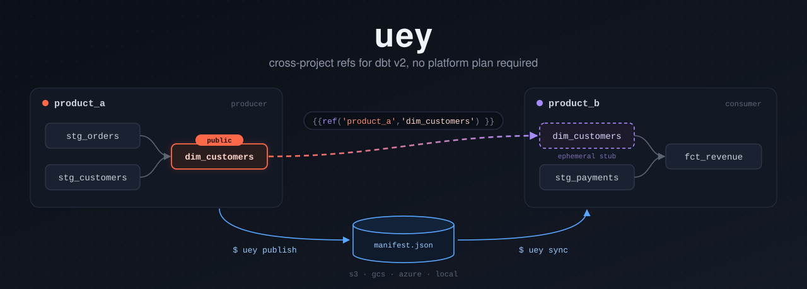

<p align="center"></p>

# uey

Cross-project `ref('project', 'model')` for dbt v2, without a dbt platform plan.

A producer project publishes a slim copy of its manifest after each run. A
consumer project syncs it before `dbt deps`, and uey writes a local dbt package
with one ephemeral stub per public model:

```sql
-- .mesh/core_platform/models/dim_customers.sql (generated)
{{ config(materialized='ephemeral') }}
select * from "analytics"."core"."dim_customers"
```

dbt then resolves `{{ ref('core_platform', 'dim_customers') }}` as an ordinary
package ref. It compiles to a CTE over the producer's table, lineage shows the
upstream model, and `dbt build` skips the stubs (`no-op`), so nothing upstream
is rebuilt. Tested on dbt v2.0.11, both `dbt-oss` and the proprietary `dbt`.

## Install

uey is not on PyPI yet. Install from GitHub, with the extra for your store:

```
pip install "uey[s3] @ git+https://github.com/dietofworms/uey"
```

Extras: `s3` (S3 and S3-compatible), `gcs` (Google Cloud Storage), `azure`
(Azure Blob / ADLS). A local or network directory needs no extra.

## Producer: publish after each run

1. Mark the models other projects may use as public:

   ```yaml
   models:
     - name: dim_customers
       config:
         access: public
   ```

2. Add a step after `dbt build` in the producer's job:

   ```
   dbt build
   uey publish --env prod --store s3://my-bucket/uey
   ```

   This reads `target/manifest.json` and writes
   `s3://my-bucket/uey/<project>/prod/manifest.json`. Only public models are
   published: their warehouse relation, description, columns and versions. SQL
   and private models stay in the producer.

Publish from every environment consumers should read, for example a staging
job with `--env staging`.

## Consumer: sync before deps

1. Add `uey.yml` next to `dbt_project.yml`:

   ```yaml
   store: s3://my-bucket/uey
   projects:
     - core_platform
   ```

2. Add `.mesh/` to `.gitignore`.

3. Run sync before dbt, locally and in the job:

   ```
   uey sync --env prod
   dbt deps
   dbt build
   ```

   The first sync adds `- local: .mesh/core_platform` to `packages.yml` (or to
   `dependencies.yml` if that is where your packages are), keeping your comments.

4. Reference upstream models:

   ```sql
   select * from {{ ref('core_platform', 'dim_customers') }}
   select * from {{ ref('core_platform', 'dim_customers', v=1) }}  -- versioned
   ```

The consumer's warehouse credentials need read access to the producer's tables.

## Environments

`--env` (or `$UEY_ENV`, default `prod`) names the environment you are running
in. By default `prod` reads the producer's `prod` manifest, and any other
environment reads its own name first, then falls back to `prod`. So `uey sync
--env dev` uses the producer's `dev` manifest if one is published, otherwise
production. Override per environment or pin a project:

```yaml
store: s3://my-bucket/uey
projects:
  - core_platform
  - name: finance
    environment: prod          # always read finance's production tables
environments:
  dev: [staging, prod]         # dev reads staging, then prod
  ci: [staging, prod]
```

## Configuration reference

| Setting | Where | Default |
|---|---|---|
| Store URL | `--store`, `$UEY_STORE`, `store:` in `uey.yml` (first wins) | none, required |
| Environment | `--env`, `$UEY_ENV` | `prod` |
| Upstream projects | `projects:` in `uey.yml` | none |
| Environment routing | `environments:` in `uey.yml` | see above |
| Stub package folder | `mesh_dir:` in `uey.yml` | `.mesh` |
| Manifest path (publish) | `--manifest` | `target/manifest.json` |

A store is a URL (`s3://`, `gs://`, `az://`, or any fsspec URL) or a directory
path. Relative paths resolve against `--project-dir`. Publishing needs write
access (on S3, `s3:PutObject`), syncing needs read access (`s3:GetObject`).
Cloud credentials come from the usual places: on S3, the standard AWS
environment variables, profile or instance role.

## Limitations

- **Contracts are not enforced across projects.** dbt does not enforce
  contracts on ephemeral models, so if the producer renames a column, the
  consumer fails when the query runs. On the proprietary `dbt`, run
  `dbt compile --static-analysis strict` in CI to catch it at compile time; it
  checks against the live warehouse schema.
- **Data tests stay with the producer.** Stubs carry no tests, so producer
  tests do not rerun in every consumer.
- **`projects:` in `dependencies.yml` does nothing** without the dbt platform.
  uey uses a `local:` package entry instead.
- Only dbt manifest schema v12 is supported (dbt v2 and recent dbt 1.x write it).
- **Tested so far:** dbt v2.0.11 (`dbt-oss` and `dbt`) with DuckDB, and the S3
  store against a local S3 server (moto). Stubs use the `relation_name` the
  producer's own manifest records, so quoting follows the warehouse, but
  Snowflake, BigQuery, Databricks and Redshift have not been run end to end.
  GCS and Azure go through the same fsspec code as S3 and are untested.

## License

Apache 2.0. See [LICENSE](LICENSE).

## Development

```
uv sync
uv run pytest -m "not dbt"   # unit tests
uv run pytest -m dbt         # end to end against dbt and DuckDB
UEY_DBT="uvx --from dbt==2.0.11 dbt" uv run pytest -m dbt   # proprietary dbt
uv run ruff check . && uv run pyright
```

`spike/` holds the Phase 0 experiments that proved the design; see
[spike/FINDINGS.md](spike/FINDINGS.md).
